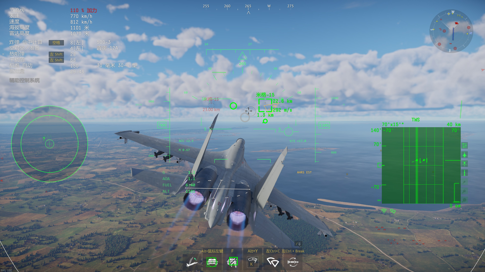
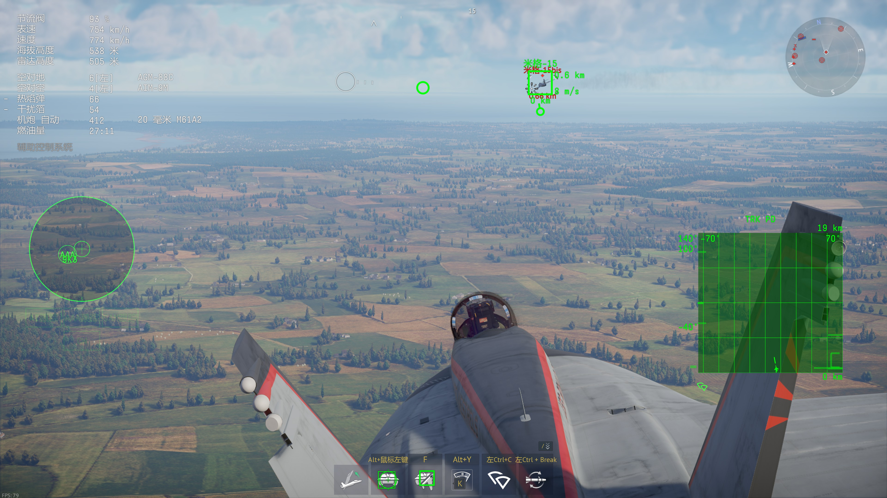

# War Thunder HUD (8111)

用官方 `localhost:8111` 接口驱动的**战争雷霆平视显示器（HUD）叠加层**，反作弊安全：**不注入、不读内存、不改文件、不拦截网络、不自动操作**。

A military-style HUD overlay for **War Thunder**, driven entirely by the official local API on
`http://127.0.0.1:8111`. Read-only: no injection, no memory reads, no file modification,
no packet interception, no automation.

---

---

## 效果截图

第三人称（HUD 全要素）：



近距离视角：


## 特性

### 显示

- **俯仰梯 + 地平线 + 坡度尺**（随姿态联动，第三人称下相机不滚转，因此梯子保持水平）
- **左侧速度带**：IAS 数字框 + 马赫数 + **纵向加速度**与趋势条
- **右侧高度带**：气压高度 + 升降率（`V/S`）与趋势条
- **顶部航向带**、**飞行矢量标记（FPM）**
- **左下数值区**：G（正/负过载分档配色）、AOA、FUEL（剩余续航时间）、ALT
- **构型提示**：起落架 / 襟翼 / 减速板 —— 运动中闪烁、到位后按状态常亮或显示 `STB`
- 超速时速度数字变红；G 值 `+9 / +12`、`-2 / -4` 分档变黄/变红

### 布局与交互

- **Z 瞄准布局**：数据带外推、俯仰梯下移、数值区下沉、航向带置顶、坡度圆弧放大，**0.28 s 平滑过渡**
- **第三人称/座舱视角感知**：座舱内自动隐藏 HUD（机头视角可选）
- **地图/计分板按住时隐藏 HUD**
- 地面也显示数据类符号（姿态类自动淡出）

### 工程

- 双机型适配：螺旋桨/早期喷气有原生地平仪（`aviahorizon_*`），顶级喷气无姿态数据 → 自动切换到合成姿态（`俯仰 = 航迹角 + AoA`）
- 面向 17–25 Hz 的接口做了**变化才提交**渲染（4K 下约 15 次/秒合成，CPU ≈ 15% 单核）
- 全部参数可现场热键标定并保存到 `hud-config.json`

---

## 运行要求

1. **Windows 10/11**，DX11 显卡
2. 游戏**显示模式设为「无边框窗口」（Fullscreen Window）** —— 独占全屏无法叠加
3. 游戏运行中（8111 服务随游戏进程启动）
4. 自定义战斗 / 自定义难度（试飞）需在自定义设置里勾选 **「允许使用网页界面」（Allow web UI）**

## 安装

从 [Releases](../../releases) 下载 `WtHud.exe`，放到**任意独立目录**（不要放在游戏根目录 —— 启动器会删除第三方 exe），双击运行即可，无需安装 .NET。

## 快捷键

| 热键 | 功能 |
|---|---|
| `F1` | 设置面板（所有参数 + 全部快捷键一览） |
| `F5` | 视角/地图状态复位 |
| `F7` | 俯仰零位校准（平飞时按下，把当前俯仰记为 0） |
| `F8` | 反转坡度方向 |
| `F9` | 纯机体固连模式（隐藏姿态类符号） |
| `F10` | HUD 显示 / 隐藏 |
| `F11` **连按两次** | 退出 |
| `F12` | 保存配置 |
| `Ctrl+Alt+↑ / ↓` | HUD 整体上移 / 下移 0.5° |
| `Ctrl+Alt+PgUp / PgDn` | 垂直视场角（角度尺度）∓1° |
| `Ctrl+Alt+R` | 相机滚转耦合 0/1 |
| `Z` | 瞄准布局切换（跟随游戏放大键） |
| `V` | 视角切换计数（座舱隐藏 HUD） |

以上 `V` / `Z` / 地图键 / 计分板键**均可在设置面板自定义**，支持 `CTRL+N`、`SHIFT+TAB` 这类组合键。
所有按键都是**被动轮询**，不会吞掉游戏输入。

## 从源码构建

需要 **.NET 8 SDK**：

```powershell
cd src/WarThunderHud
./build.ps1          # 编译
./run-hud.ps1        # 运行（默认 1 小时）
./run-hud.ps1 -Demo  # 不开游戏也能看 HUD 长什么样
```

发布单文件 exe：

```powershell
dotnet publish src/WarThunderHud/WarThunderHud.csproj -c Release -r win-x64 `
  --self-contained true -p:PublishSingleFile=true `
  -p:IncludeNativeLibrariesForSelfExtract=true -o dist
```

其他诊断模式：`WtHud.exe selftest`（解析单测）、`fusiontest`（姿态融合场景）、`preview out.png`（渲染 PNG）、`probe`（实时遥测）。

---

## 数据来源与限制

| 数据 | 来源 | 说明 |
|---|---|---|
| 速度/高度/马赫/G/AoA/AoS/升降率/油量 | `/state` | 所有机型都有 |
| 航向/原生地平仪/弹药 | `/indicators` | 仅部分机型有 |
| 地图/聊天/击杀日志 | `/map_obj.json` 等 | 本 HUD **不使用**（见合规说明） |

已知限制：

- **顶级喷气无原生姿态**：俯仰/坡度靠 `航迹角 + AoA` 与转弯率合成，稳态可用、剧烈机动有偏差，HUD 会标注 `AHRS EST`
- 接口更新率约 17–25 Hz（游戏侧节流），HUD 用预测/插值补偿但仍有轻微滞后
- 襟翼档位、油量续航等为**推算值**，与游戏内显示可能存在差异（续航可在设置里用标定系数对齐）

## 合规说明（重要）

- 本工具**只读取**游戏自带的本地 HTTP 接口，不修改客户端、不注入进程、不读取内存、不修改游戏画面渲染
- **不显示敌人位置、不做 ESP**。不使用 `/map_obj.json` 绘制敌情
- 官方论坛口径：使用 localhost 数据做 overlay 一般允许，但官方不对第三方工具作任何保证，**使用风险自负**
- 请遵守 Gaijin 用户协议与各服务器规则；因使用本工具产生的任何后果由使用者承担

## 目录结构

```
src/WarThunderHud/
  Telemetry/   8111 客户端、解析、能力探测、姿态融合
  Hud/         符号基元、几何布局、标定、配置
  Graphics/    D3D11/D2D 画布、绘制器、PNG 输出
  Overlay/     Win32 窗口、DirectComposition、热键
  Input/       按键绑定解析（支持组合键）
  UI/          设置面板（WinForms）
docs/          设计文档与接口调研
```

## 许可

本项目采用 **[GNU AGPL-3.0](LICENSE)** 许可。

这意味着：

- ✅ 可以自由使用、修改、分发
- ✅ 可以fork、二次开发、发布自己的版本
- ⚠️ **衍生作品必须同样以 AGPL-3.0 开源**
- ⚠️ **如果把修改版做成网络服务（SaaS/网页/API）提供给他人使用，也必须公开源码**（AGPL 第 13 条）

简单说：**不禁止"用"，但禁止"拿着改一改就闭源商用"**。

如需商业授权（豁免上述条款），请联系作者。

---

*本项目与 Gaijin Entertainment 无关。War Thunder 是 Gaijin Entertainment 的商标。*


