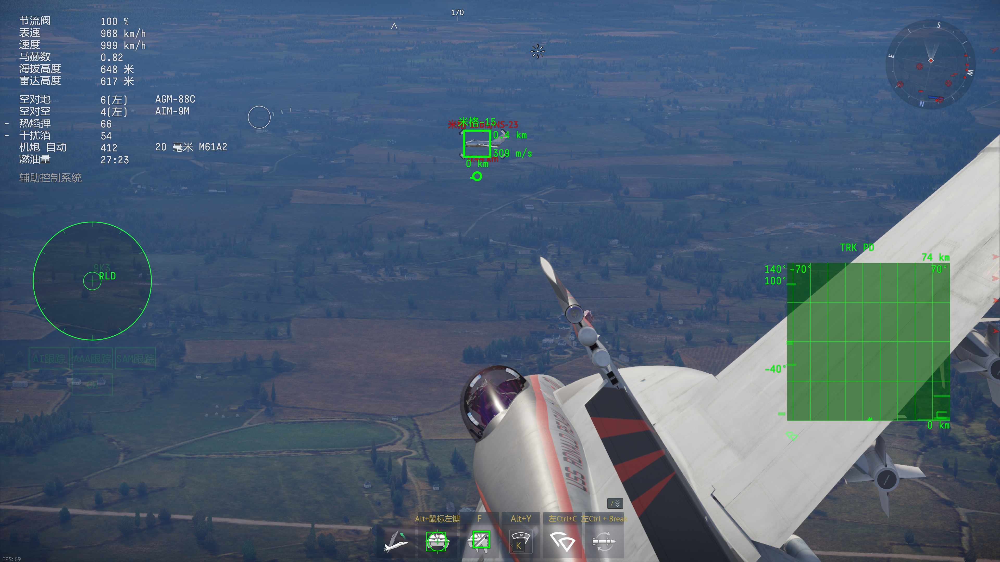
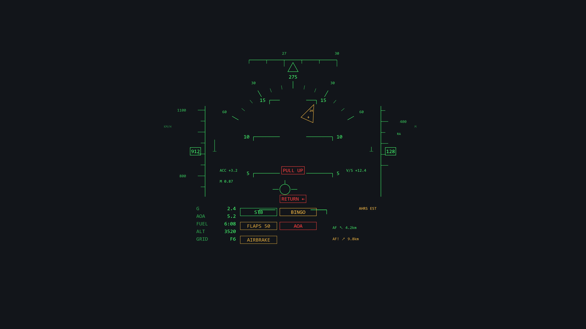

# War Thunder HUD (8111)

用官方 `localhost:8111` 接口驱动的**战争雷霆平视显示器（HUD）叠加层**，反作弊安全：**不注入、不读内存、不改文件、不拦截网络、不自动操作**。

A military-style HUD overlay for **War Thunder**, driven entirely by the official local API on
`http://127.0.0.1:8111`. Read-only: no injection, no memory reads, no file modification,
no packet interception, no automation.

当前版本 **v0.1.4** · [更新日志](CHANGELOG.md) · [AGPL-3.0](LICENSE)

---

## 效果截图

第三人称（HUD 全要素）：


近距离视角：



全部要素示意（模拟渲染，非游戏截图）：



## 特性

### 姿态与基准符号

- **俯仰梯 + 地平线 + 坡度尺**（第三人称相机不滚转，梯子保持水平；相机俯仰耦合已补偿）
- **坡度指针**：沿圆弧指示坡度，指针内显示**滚转角度数**与 `+`（机腹朝下）/ `-`（机腹朝上）
- **飞行矢量标记（FPM）**：实时显示航迹方向，可微调偏置

### 两侧数据带

| 位置 | 内容 |
|---|---|
| 左侧（速度带） | IAS 数字框、`M` 马赫数、`ACC` 纵向加速度 + 趋势条 |
| 右侧（高度带） | 气压高度（`H`）、`V/S` 升降率 + 趋势条 |
| 顶部 | 航向带，读数随航向滚动 |

- 两条趋势条**零点对齐屏幕中心线**，起点各有一段短横线基线，量程：爬升率 0–100 m/s → 5°，加速度 0–10 m/s² → 5°
- 走带刻度每 50 km/h / 100 m 一格，主刻度标数值

### 左下数值区

| 行 | 内容 | 颜色规则 |
|---|---|---|
| `G` | 法向过载 | ≥9 黄，≥12 红；≤−2 黄，≤−4 红 |
| `AOA` | 迎角 | 绿 |
| `FUEL` | **剩余续航时间**（`mm:ss`） | <5 min 黄，<2 min 红；无油耗数据时 `--:--` |
| `ALT` | 气压高度 | 绿 |
| `GRID` | 地图网格坐标（如 F2） | 绿 |

> `FUEL` 是"按当前油耗还能飞多久"，用 12 秒滑动窗口最小二乘估计油耗，可在设置里用标定系数对齐游戏内显示。

### 构型提示（中偏左）

| 提示 | 运动中 | 到位后 |
|---|---|---|
| 起落架 | 琥珀**闪烁** `GEAR DOWN` / `GEAR UP` | 绿色常亮 `STB` 0.8 秒 |
| 襟翼 | 琥珀**闪烁** `FLAPS DOWN` / `FLAPS UP` | 常亮 `FLAPS <档位>`（收回 0 后消失） |
| 减速板 | 琥珀**闪烁** `AIRBRAKE OUT` / `AIRBRAKE IN` | 常亮 `AIRBRAKE`（提示仍处于展开状态） |

三者共用同一列、随 `Z` 瞄准布局一起下沉。

### 告警（原有）

- **超速**：IAS 超过阈值（默认 1400 km/h，可调）时速度数字变红
- **过载**：见上表 G 值配色
- **油量**：续航低于 2 分钟变红

### 导航与告警

- **导航**：`GRID` 网格坐标；最近友方 / 敌方机场的相对方位与距离（`AF ↗ 4.2km`）；距地图边缘过近时闪烁红色 `RETURN ↑`；
  距**敌方机场**小于设定距离（默认 12 km，可调）时 `AF!` 变为闪烁框
- **地形告警**：`SINK RATE`（低空 + 大下降率，全机型）；有机型雷达高度表时升级为 `PULL UP`（触发高度随下降率提高）
- **超速**：速度数字变红 + 左右各一个闪烁红框 `REDUCE SPEED`；阈值可用 IAS(km/h) 或 Mach，机型有 `vne` 时自动用 vne
- **失速**：闪烁 `STALL`（琥珀=预失速，红=失速）。判定优先用**按机型校准值**（飞行中按 `Ctrl+Alt+S` 记录临界迎角），
  其次用座舱迎角指示灯，最后用通用阈值（默认 22°）；且要求机翼卸载（Ny < 2.5）才告警，避免高速大过载误报
- **其它告警**：`AOA` 过大、`BINGO` 油量见底、`RETURN` 边界警示
- **只读且只取自身/机场数据**：不读取、不绘制任何敌方单位（见合规说明）

### 布局与交互

- **Z 瞄准布局**：数据带外推、俯仰梯下移、数值区下沉、航向带置顶、坡度圆弧放大，**0.28 s 平滑过渡**
- **视角感知**：座舱内自动隐藏 HUD（机头视角可选），`V` 键计数视图切换
- **地图 / 计分板按住时隐藏 HUD**
- **地面也显示数据类符号**（姿态类自动淡出，避免地面 AoA/AoS 噪声）
- **光标洞可调**：`Ctrl+Alt+H` 循环 0/32/48/64/80/112/140 px（默认 32 px），
  越小越不会遮挡飞行矢量；配合光标看门狗自动清理残留箭头

### 工程

- **双机型适配**：
  - 有原生地平仪（`aviahorizon_pitch` / `aviahorizon_roll`）→ **原生数据直通**，标注 `AHRS GAME`
  - 顶级喷气无姿态数据 → 合成姿态（`俯仰 = 航迹角 + AoA`，坡度由转弯率给出），标注 `AHRS EST`
- 面向 17–25 Hz 的接口做了**变化才提交**渲染（4K 下约 15 次/秒合成，CPU ≈ 15% 单核）
- 全部参数可现场热键标定并保存到 `hud-config.json`（exe 同目录）

## 运行要求

1. **Windows 10/11**，DX11 显卡
2. 游戏**显示模式设为「无边框窗口」（Fullscreen Window）** —— 独占全屏无法叠加
3. 游戏运行中（8111 服务随游戏进程启动）
4. 自定义战斗 / 自定义难度（试飞）需在自定义设置里勾选 **「允许使用网页界面」（Allow web UI）**

## 安装

从 [Releases](../../releases) 下载 `WtHud.exe`（或 zip），解压到**任意独立目录**
（不要放在游戏根目录 —— 启动器会删除第三方 exe），**双击运行**即可，无需安装 .NET。

- 首次运行会在同目录生成 `hud-config.json`
- 运行时长不限，**连按两次 `F11`** 退出（单次按不会退出，防误触）
- 想改参数按 `F1` 打开设置面板

## 快捷键

除下面三个固定组合外，**其余键位都可以在 F1 设置面板里逐项自定义**（支持 `CTRL+N`、`SHIFT+TAB`、`ALT+F1` 这类组合键）。

### 固定（不可改）

| 热键 | 功能 |
|---|---|
| `Ctrl+Alt+↑ / ↓` | HUD 整体上移 / 下移 0.5° |
| `Ctrl+Alt+PgUp / PgDn` | 垂直视场角（角度尺度）∓1° |
| `Ctrl+Alt+R` | 相机滚转耦合 0/1 |

### 可自定义（括号内为默认值）

| 功能 | 默认键 |
|---|---|
| 显示 / 隐藏 HUD | `F10` |
| 纯机体固连模式 | `F9` |
| 退出（连按两次） | `F11` |
| 设置面板 | `F1` |
| 俯仰零位校准 | `F7` |
| 坡度方向翻转 | `F8` |
| 保存配置 | `CTRL+F12`（F12 被 Steam 截图占用） |
| 光标洞尺寸循环 | `CTRL+ALT+H` |
| 视角切换计数 | `V` |
| 瞄准布局切换 | `Z` |
| 地图（按住隐藏 HUD） | `M` |
| 计分板（单击切换隐藏） | `CTRL+N` |
| 长按隐藏 HUD | `U` |
| 状态复位（视角/地图/计分板） | `F5` |

所有按键要么是被动轮询、要么是系统热键注册；轮询的键**不会吞掉游戏输入**，热键被其他程序占用时会在日志里提示。
## 配置项（`hud-config.json`）

| 字段 | 含义 | 默认 |
|---|---|---|
| `verticalFovDeg` | 垂直视场角（角度→像素换算） | 43 |
| `layoutOffsetYDeg` | HUD 整体垂直偏移（度） | 1.8 |
| `pitchZeroDeg` | 俯仰零位 | 0 |
| `bankSign` / `bankTrimDeg` | 坡度方向 / 微调 | 1 / 0 |
| `fpmTrimDeg` / `fpmAosSign` | 飞行矢量纵向偏置 / 横向符号 | 0 / -1 |
| `rollCoupling` | 相机滚转耦合 | 0 |
| `extrapolate` | 速度/高度预测（默认关） | false |
| `hudVisible` | HUD 总开关 | true |
| `showPitchLadder` / `showFpm` | 显示俯仰梯 / 飞行矢量 | true / true |
| `hideInCockpit` / `hideInNose` | 座舱 / 机头视角隐藏 | true / false |
| `hideOnGround` / `groundHideSpeedKmh` / `groundHideDelayMs` | 地面隐藏 / 判定速度 / 延迟 | true / 5 / 500 |
| `tapeRadarAltitude` | 高度带优先显示雷达高度（机型支持时） | true |
| `cursorHoleHalfPx` | 光标洞半径（px，0 = 关闭） | 16 |
| `overspeedKmh` | 超速阈值（IAS，机型无 `vne` 时使用） | 1400 |
| `overspeedByMach` / `overspeedMach` | 改用马赫判定 / 马赫阈值 | false / 1.80 |
| `stallKey` / `stallAoaDeg` / `stallAoaByVehicle` | 失速校准键 / 通用阈值 / 每机型校准表 | CTRL+ALT+S / 22 / {} |
| `enemyAirfieldAlertKm` | 敌机场告警距离（km，0=关闭） | 12 |
| `pitchSign` | 原生俯仰符号（0=自动判定） | 0 |
| `aoaWarnDeg` | AOA 告警阈值（度） | 18 |
| `bingoFuelSeconds` | BINGO 油量阈值（秒） | 180 |
| `enduranceScale` | 续航标定系数（对齐游戏读数） | 1.30 |
| `mapYFlip` / `edgeMarginFraction` | 地图 Y 轴翻转 / 边界告警范围 | true / 0.06 |
| `viewKey` `zoomKey` `mapKey` `scoreboardKey` `holdHideKey` `resetKey` `settingsKey` `pitchZeroKey` `bankFlipKey` `bodyFixedKey` `showKey` `exitKey` `saveKey` `cursorHoleKey` | 全部可自定义键位 | 见上表 |
## 从源码构建

需要 **.NET 8 SDK**：

```powershell
cd src/WarThunderHud
./build.ps1          # 编译
./run-hud.ps1        # 运行
./run-hud.ps1 -Demo  # 不开游戏也能看 HUD 长什么样
```

发布单文件 exe：

```powershell
dotnet publish src/WarThunderHud/WarThunderHud.csproj -c Release -r win-x64 `
  --self-contained true -p:PublishSingleFile=true `
  -p:IncludeNativeLibrariesForSelfExtract=true -o dist
```

其他诊断模式（命令行参数）：`overlay`（HUD）、`probe`（实时遥测）、`selftest`（解析单测）、
`fusiontest`（姿态融合场景）、`preview out.png`（渲染 PNG）、`replay <file.jsonl>`（回放）、`dumpgeo`。

## 数据来源与限制

| 数据 | 来源 | 说明 |
|---|---|---|
| 速度/高度/马赫/G/AoA/AoS/升降率/油量/襟翼/起落架/减速板 | `/state` | 所有机型都有 |
| 航向/原生姿态/弹药 | `/indicators` | 仅部分机型有 |
| 地图/聊天/击杀日志 | `/map_obj.json` 等 | 本 HUD **不使用**（见合规说明） |

已知限制：

- **顶级喷气无原生姿态**：俯仰/坡度靠 `航迹角 + AoA` 与转弯率合成，稳态可用、剧烈机动有偏差，HUD 会标注 `AHRS EST`
- **原生姿态是座舱陀螺仪读数**：`AHRS GAME` 机型按游戏数据直通显示，极端姿态下与真实姿态可能有偏差（这是仪表本身的特性）
- 接口更新率约 17–25 Hz（游戏侧节流），HUD 用预测/插值补偿但仍有轻微滞后
- 续航、襟翼档位等为**推算值**，可能与游戏内显示不同（续航可用标定系数对齐）
- 游戏使用**软件光标**，叠加层与光标归属存在竞争，因此保留了可调光标洞 + 看门狗机制

## 合规说明（重要）

- 本工具**只读取**游戏自带的本地 HTTP 接口，不修改客户端、不注入进程、不读取内存、不修改游戏画面渲染
- **不显示敌人位置、不做 ESP**。不使用 `/map_obj.json` 绘制敌情
- 官方论坛口径：使用 localhost 数据做 overlay 一般允许，但官方不对第三方工具作任何保证，**使用风险自负**
- 请遵守 Gaijin 用户协议与各服务器规则；因使用本工具产生的任何后果由使用者承担

## 目录结构

```
src/WarThunderHud/
  Telemetry/   8111 客户端、解析、能力探测、姿态融合
  Hud/         符号基元、几何布局、标定、配置
  Graphics/    D3D11/D2D 画布、绘制器、PNG 输出
  Overlay/     Win32 窗口、DirectComposition、光标洞、热键
  Input/       按键绑定解析（支持组合键）
  UI/          设置面板（WinForms）
docs/          设计文档、接口调研、视角实验
```

## 许可

本项目采用 **[GNU AGPL-3.0](LICENSE)** 许可。

- ✅ 可以自由使用、修改、分发
- ✅ 可以 fork、二次开发、发布自己的版本
- ⚠️ **衍生作品必须同样以 AGPL-3.0 开源**
- ⚠️ **如果把修改版做成网络服务（SaaS / 网页 / API）提供给他人使用，也必须公开源码**（AGPL 第 13 条）

简单说：**不禁止"用"，但禁止"拿着改一改就闭源商用"**。如需商业授权（豁免上述条款），请联系作者。

---

*本项目与 Gaijin Entertainment 无关。War Thunder 是 Gaijin Entertainment 的商标。*


